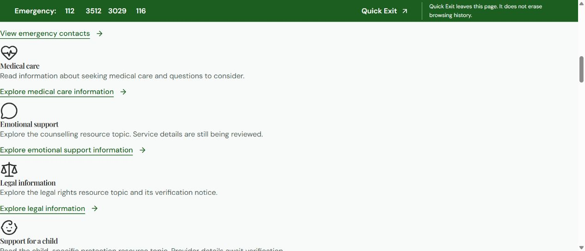
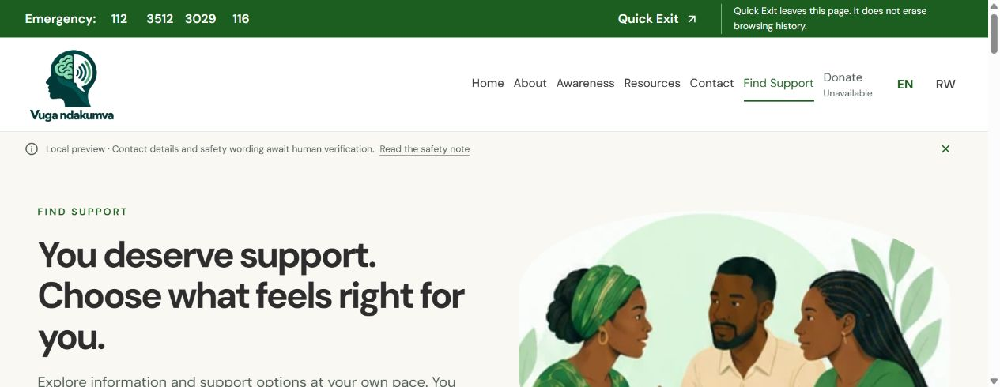
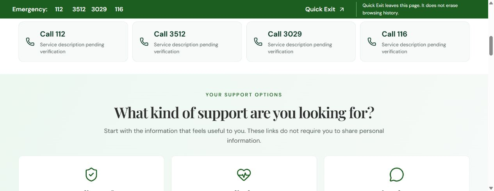
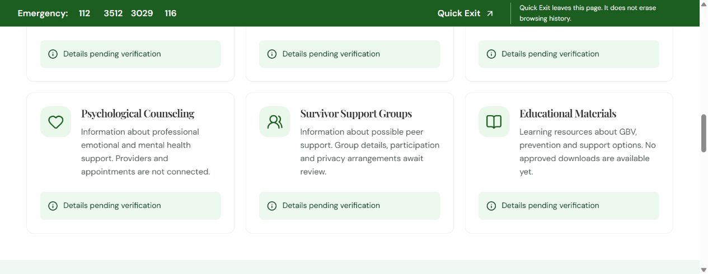
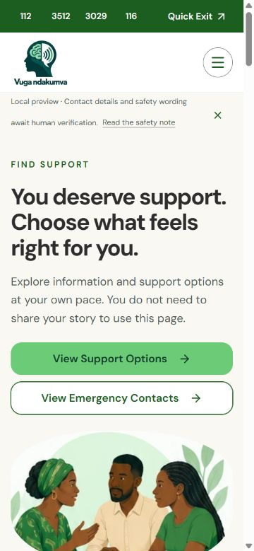

# Find Support audit — 20 October 2026

Fresh Chrome audit of the user-open preview on port 5192 and the current build on port 5194. Desktop: 1280×551. Mobile: 375×812; viewport reset afterward. No application code changed.

The later pasted support-options brief supersedes the earlier mental-wellbeing design. The directory empty state and absence of filters follow that later brief; they are not implementation defects.

## 1. Existing preview — critical visual failure

The user's open page lacks the Find Support stylesheet, including after reload. The hero/category grids compute to display:block and the content wrapper has zero padding. This produces an unstructured list flush to the window. The shared emergency bar remains visible. Likely stale preview routing/configuration; the precise process cause was not inspected. Fix the actual preview URL/configuration before judging or rebuilding the design.

## 2. Current desktop entrance — functional, oversized

Port 5194 has the route stylesheet and working grids. Branding and the safety bar are clear. The long heading and large illustration put the hero actions below the initial view at the observed desktop height. The image's natural width is 332px, displayed at about 553px, making it soft. Compact the hero and use the approved artwork closer to its native size or obtain a higher-resolution original.

## 3. Primary action — working, inefficient landing

View Support Options navigates to #support-options. After scrolling settles, the heading begins around 269px below the viewport top; preceding phone cards still occupy much of the view, and category links remain below. Tighten the anchor offset and spacing, improve scanning of six equal-weight choices, and reduce repeated status wording without concealing review notices.

## 4. Emotional-support path — high-priority usefulness gap

Explore emotional support information successfully navigates to /resources#resource-counseling. The destination offers a generic description and a disabled Details pending verification control, with no substantial counselling guidance or verified provider. This is a working URL with an unhelpful destination. Provide reviewed information about counselling and questions to ask before sending visitors to a pending listing. Never fabricate services or imply availability. Other category links were inspected in the DOM but not individually followed during this audit.

## 5. Mobile entrance — readable, choices too far down

At 375×812 there is no observed horizontal overflow. The primary action is visible around y=505 and is 48px high. Emergency links and Quick Exit remain visible. However, the support category section starts around y=1343, after the long hero, illustration and urgent-help block. Reduce hero image size/vertical spacing and make the urgent-help block compact, bringing actual choices closer to the entrance.

## Content blockers and priorities
The four numbers lack verified service descriptions in approved project records. Pending labels are honest but cannot help a visitor distinguish which number serves their need. This requires operational approval, not guessed labels. Directory records and native RW wording remain pending.

Priority: (1) correct the broken preview handoff; (2) make support choices lead to useful reviewed guidance; (3) compact hero, urgent help and anchor landing; (4) reduce upscaled artwork and repeated status clutter; (5) obtain verified service labels/directory content.

## Limits
Fresh visual/DOM and task-flow audit only. No new axe, Lighthouse, screen-reader, exhaustive keyboard, no-JavaScript or Quick Exit execution tests were run. Visible controls do not establish full accessibility compliance. No contacts activated, personal information submitted, dependencies installed, Git used or deployment performed. Correctly styled preview left open in Chrome.
